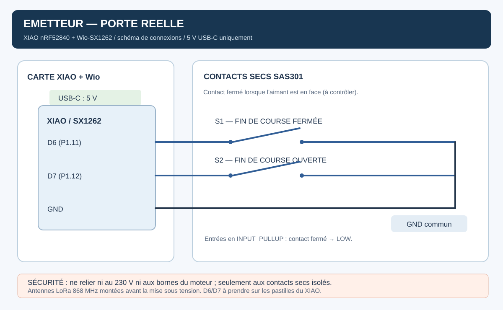

# GarageStateClone — garage miniature LoRa, prototype V1

Reproduire dans une maquette l'état de la vraie porte de garage, sans jamais la commander. Deux kits **Seeed Studio XIAO nRF52840 + Wio-SX1262 à deux barrettes de 7 broches** communiquent directement en LoRa ; ce n'est **pas** la variante Wio B2B pour ESP32-S3.

**État du projet : prototype documentaire et logiciel à valider.** Le dépôt contient un firmware commun à deux rôles, quatre documents et trois SVG. Il ne contient **aucun STL** et aucune validation physique sur table, mécanique ou radio n'est démontrée. Les références dites « vérifiées » dans les documents correspondent à une revue documentaire, pas à une qualification matérielle. Ce README centralise la V1 retenue ; les documents détaillés restent disponibles en fin de page.

## Sommaire

- [Architecture et sécurité](#architecture-et-sécurité)
- [Matériel et nomenclature complète](#matériel-et-nomenclature-complète)
- [Mécanique retenue](#mécanique-retenue)
- [Câblage et schémas](#câblage-et-schémas)
- [États, angles et LED](#états-angles-et-led)
- [Protocole radio et limites](#protocole-radio-et-limites)
- [Compilation et flash](#compilation-et-flash)
- [Essais et réglages à réaliser](#essais-et-réglages-à-réaliser)
- [Documents, inventaire et sources](#documents-inventaire-et-sources)

## Architecture et sécurité

- **Émetteur, dans le vrai garage** : deux contacts magnétiques miniatures **SAS308**, un en fin de course fermée et un en fin de course ouverte ; alimentation USB-C 5 V isolée.
- **Récepteur, dans la maison** : un **DFRobot DMS-MG90** anime uniquement la porte miniature ; une LED blanche chaude éclaire l'intérieur et une LED orange discrète signale les états et anomalies.
- **Liaison directe 868,125 MHz** : sans passerelle, réseau maillé ni Internet. Aucun fil ne relie les deux appareils. Internet n'est nécessaire que pour installer les outils/dépendances au premier build.

**Sécurité impérative :**

- Aucun GPIO ne doit être relié au **230 V**, aux bornes du moteur, à une sortie relais ou à un connecteur de sécurité de la motorisation. Utiliser exclusivement les contacts secs isolés des SAS308 ; conserver toutes les sécurités de la vraie porte.
- Installer capteurs et fils hors des pièces mobiles, ressorts et galets ; éviter tout accrochage et protéger les raccordements de l'humidité.
- GPIO en **3,3 V** : jamais de 5 V sur une entrée/sortie. Le servo est alimenté en **5 V externe**, jamais depuis le 3V3, un GPIO ou les petites pistes du module.
- Répartir la puissance **avant les cartes** et relier les masses du récepteur, du servo et du transistor. Avec deux chargeurs côté miniature, réunir les GND mais **jamais leurs deux +5 V**.
- Brancher les **antennes 868 MHz adaptées avant toute émission**. Couper les alimentations avant de modifier le câblage.
- Usage **indicatif uniquement** : ni dispositif de sécurité, ni preuve de fermeture, ni système d'alarme. Les trames ne sont pas authentifiées et les capteurs ne sont pas supervisés.

## Matériel et nomenclature complète

### Déjà disponible — ne pas racheter

| Quantité | Matériel | À contrôler |
|---:|---|---|
| 2 | Kits XIAO nRF52840 + Wio-SX1262, connecteurs 2 × 7, SKU 102010710 | Antennes 868 MHz et accès aux pastilles D6/D7 du XIAO |
| 1 | Bambu Lab P1S + AMS | Filaments blanc, noir, bleu et rouge disponibles ; privilégier des pièces séparées par couleur |
| 1 | Prise secteur dans le garage réel | Pour un chargeur USB isolé seulement, sans liaison à la motorisation |

### Électronique à monter / achats indicatifs

Prix **historiques indicatifs TTC issus de la nomenclature du 21 novembre 2026**, non revérifiés ici. Les liens sont des références d'achat, sans garantie de prix, disponibilité ou délai actuel.

| Quantité montée | Pièce / référence | Prix historique pris en compte | Caractéristiques / usage |
|---:|---|---:|---|
| 2 | [SAS308 — Gotronic 26449](https://www.gotronic.fr/art-contact-magnetique-miniature-sas308-12751.htm) | 3,90 € chacun, soit 7,80 € | Aimants inclus, vis non fournies ; 24 × 15 × 6 mm, distance maxi 15 mm, câble moulé de 25 cm par capteur ; contact fermé aimant en face, à vérifier au multimètre |
| 1 | [DFRobot DMS-MG90 — Gotronic 36923](https://www.gotronic.fr/art-servomoteur-dms-mg90-32266.htm) | 7,90 € | Positionnel, pignons métal, 4,8–6 V, course annoncée 2 × 90° ; palonnier et visserie inclus |
| 1 | [470 µF / 16 V — Gotronic 04947](https://www.gotronic.fr/art-condensateur-radial-470uf-16v-3386.htm) | 0,20 € | Condensateur polarisé près du servo |
| 1 | [BC547B NPN TO-92 — Gotronic 02173](https://www.gotronic.fr/art-transistor-bc547b-1336.htm) | 0,15 € | Q1, commande de la LED blanche depuis D7 ; identifier C/B/E sur la notice du lot |
| 1 utilisée | [330 Ω — Gotronic 04130](https://www.gotronic.fr/art-5-resistances-1-2w-330-8486-2653.htm) | 0,30 € le lot de 5 | R1, série LED blanche sur +5 V |
| 1 utilisée | [680 Ω — Gotronic 04134](https://www.gotronic.fr/art-5-resistances-1-2w-680-8486-2657.htm) | 0,30 € le lot de 5 | R4, série LED orange sur 3V3 |
| 1 utilisée | [4,7 kΩ — Gotronic 04144](https://www.gotronic.fr/art-5-resistances-1-2w-4-7-k-8486-2667.htm) | 0,30 € le lot de 5 | R2, D7 vers base de Q1 |
| 1 utilisée | [100 kΩ — Gotronic 04160](https://www.gotronic.fr/art-5-resistances-1-2w-100-k-8486-2681.htm) | 0,30 € le lot de 5 | R3, rappel base de Q1 vers GND |
| 1 | [LED blanche chaude 3 mm 3000 K — 304WC2J-W6-3PD](https://rptronics.fr/led-blanche-chaude-ronde-3mm-5000-8500mcd-304wc2j-w6-3pd%2C179414.html) | 0,19 € pièce, minimum 10, soit 1,90 € | Vf annoncée 2,6–3,6 V ; alimentée en 5 V via R1 et Q1 |
| 1 | [LED orange 3 mm non clignotante — LED3OLN](https://www.lextronic.fr/leds-18-mm-a-3-mm-10919) | 0,40 € | Clignotement logiciel ; variante L-7104SEC-H à 0,80 € non retenue dans le sous-total |

**Sous-total indicatif historique : 19,55 EUR TTC**, incluant les quatre lots de résistances et le minimum de dix LED blanches, **hors port, consommables, alimentations, câbles, borniers et fixation** ; les kits déjà disponibles ne sont pas comptés. Ce n'est pas le budget complet. Utiliser les LED du stock si compatibles évite des commandes supplémentaires ; les délais de livraison restent à confirmer au panier.

### Fournitures nécessaires si absentes

- Au minimum **deux alimentations USB 5 V** : une pour l'émetteur, une **5 V / 2 A minimum** pour la miniature.
- Un **répartiteur de puissance 5 V externe** côté miniature : branche USB-C XIAO et branche 5 V/GND distincte pour servo + LED blanche. Variante : chargeur supplémentaire pour servo + LED blanche, avec GND commun et +5 V séparés.
- **Deux câbles USB-C**, plus le câble/dispositif de distribution d'alimentation du servo.
- Fils souples, fil deux conducteurs pour prolonger les **25 cm moulés de chaque SAS308**, borniers/connecteurs, petite plaque à souder, gaine thermorétractable et isolants.
- Vis pour les deux SAS308, raccordements protégés, supports imprimés du servo et des LED, adaptateur de palonnier, axe/tourillon et palier gauche, coque et toit démontable.
- Multimètre pour continuité, polarités, résistances, tensions et masses ; outillage de soudure et fixation adapté.

## Mécanique retenue

Garage bas et discret : **murs blancs, toit plat noir amovible, porte noire rainurée horizontalement, très fin liseré bleu** au-dessus de la porte. Le visuel de référence est un objet posé sur une étagère ; ce n'est pas un plan coté.

La porte est **monobloc et bascule vers l'intérieur** autour de l'axe horizontal supérieur de la façade. Fermée, elle est verticale ; ouverte, elle se range sous le toit, vers 90° géométriques. L'aspect sectionnel est purement décoratif : **pas de panneaux articulés, rails courbes, ficelle, poulie, crémaillère ni bielle**.

- **DMS-MG90 fixe en haut à droite**, arbre de sortie **coaxial à la charnière supérieure**, entraînement direct par palonnier vissé et adaptateur imprimé.
- **Palier imprimé à gauche**, avec portée/tourillon pour limiter l'effort latéral sur le servo.
- Porte légère et rigide ; une épaisseur de départ d'environ 2 mm reste à ajuster. Prévoir jeux et butées sans jamais maintenir le servo en effort contre une butée.
- Pour une porte de hauteur H, réserver **au moins H + marge vers l'arrière depuis l'axe** ; vérifier toute la trajectoire, épaisseur et accouplement compris. Aucune voiture décorative, LED, électronique ou fil dans le volume balayé.
- Compartiment technique arrière hors débattement ; LED blanche sous le toit vers l'arrière, tournée vers le plancher ; LED orange 3 mm discrètement encastrée en haut à droite de façade, câbles le long de la paroi.
- Toit démontable, servo/palonnier démontables, USB-C accessible ; antenne éloignée du métal, du servo et des fils 5 V autant que possible. Tester aussi coque fermée.

**Aucune cote de coque ou de porte n'est figée.** Mesurer les composants réels avant modélisation : ne pas réutiliser les anciennes dimensions hypothétiques. Les angles logiciels 15°/55°/95° ne sont pas des mesures géométriques validées de la porte.

## Câblage et schémas

Les SVG sont des **schémas électriques de principe**, pas des plans PCB ni des vues physiques des broches. Le module Wio relie déjà la radio au XIAO : **aucun SPI supplémentaire à câbler**. D6 et D7 ne sont pas routées sur la carte Wio ; accéder aux **pastilles du XIAO** monté, vérifier à l'ohmmètre, souder et isoler soigneusement.

### Brochage commun et radio

| Signal XIAO | Broche nRF52840 | Usage |
|---|---|---|
| D0 | P0.02 | Récepteur : orange ; partagé avec bouton Wio vers GND et pull-up 10 kΩ vers 3V3 |
| D1 | P0.03 | LoRa DIO1 |
| D2 | P0.28 | LoRa RESET |
| D3 | P0.29 | LoRa BUSY |
| D4 | P0.04 | LoRa NSS |
| D5 | P0.05 | Commutateur RF ; HIGH active la commande par DIO2 |
| D6 | P1.11 | Émetteur : contact fermé ; récepteur : signal servo |
| D7 | P1.12 | Émetteur : contact ouvert ; récepteur : commande Q1 |
| D8 / D9 / D10 | P1.13 / P1.14 / P1.15 | SPI radio SCK / MISO / MOSI |

### Émetteur — vraie porte

| Départ | Arrivée |
|---|---|
| Chargeur USB isolé 5 V | USB-C du XIAO émetteur |
| D6 | Fil 1 du SAS308 « fermé » |
| D7 | Fil 1 du SAS308 « ouvert » |
| GND XIAO | Fil 2 de chacun des deux SAS308 |
| Connecteur antenne Wio | Antenne 868 MHz adaptée |

Entrées en `INPUT_PULLUP` : **aimant en face → contact fermé → LOW** ; aimant éloigné → circuit ouvert → HIGH. La désignation commerciale « NF » ne remplace pas un contrôle de continuité de chaque exemplaire. Viser nettement moins que les **15 mm maximum** pour garder une marge contre les vibrations. Aucun bornier intégré aux capteurs ; protéger les prolongations des fils moulés.



### Récepteur — miniature, netlist point à point

| Nœud / composant | Connexions à réaliser |
|---|---|
| D6 | Fil signal du DMS-MG90 uniquement |
| +5 V externe | Alimentation positive servo, borne + de C1, entrée de R1 330 Ω |
| GND commun | GND XIAO, GND alimentation servo, GND servo, borne − de C1, émetteur E de Q1, bas de R3 |
| LED blanche | +5 V externe → R1 330 Ω → anode LED ; cathode LED → collecteur C de Q1 |
| Q1 BC547B | Collecteur C vers LED blanche ; émetteur E vers GND ; base B vers R2 et R3 |
| D7 | D7 → R2 4,7 kΩ → base B de Q1 |
| R3 100 kΩ | Base B de Q1 → GND, maintien éteint au démarrage |
| LED orange | 3V3 XIAO → R4 680 Ω → anode LED ; cathode LED → D0 |
| C1 470 µF / 16 V | En parallèle près du servo : + au +5 V externe, bande − côté GND |
| USB-C XIAO | Branche d'alimentation distincte de la branche de puissance servo |

**LED blanche :** une Vf annoncée à 3,5 V ne permet pas de garantir l'éclairage depuis D7 en 3,3 V. Le montage retenu fournit le courant depuis **+5 V via 330 Ω et BC547B** ; D7 HIGH commande l'allumage, LOW l'extinction. Vérifier C/B/E selon la notice du transistor livré, pas selon la seule forme TO-92. Cette branche vise une LED THT de faible courant, **pas une LED de puissance 1 W/3 W**.

**LED orange :** D0 est partagé avec le bouton Wio. Le firmware l'allume en **sortie LOW**, l'éteint en **INPUT haute impédance**, et **ne doit jamais le piloter en sortie HIGH** avec ce câblage. Un appui sur le bouton peut également allumer la LED ; ce n'est pas une commande de porte.

Le condensateur aide lors des appels de courant du servo mais ne remplace pas une alimentation adaptée. Ne pas faire transiter cette puissance dans le XIAO.


## États, angles et LED

Les contacts détectent des **fins de course, pas un mouvement continu**. « Intermédiaire » signifie ni complètement fermé ni complètement ouvert, même si la vraie porte est immobile.

| État / situation | Contacts fermé / ouvert | Cible servo | LED blanche | LED orange |
|---|---|---|---|---|
| 0 — Fermé, déplacement terminé | Actif / inactif | 15° | Éteinte | Éteinte |
| 1 — Ouvert, déplacement terminé | Inactif / actif | 95° | Allumée fixe | Fixe |
| 2 — Intermédiaire, servo arrivé, moins de 40 s depuis le changement d'état | Inactif / inactif | 55° | Éteinte | 1 Hz |
| 2 — Intermédiaire prolongé, servo arrivé, à partir de 40 s | Inactif / inactif | 55° | Éteinte | Fixe |
| Déplacement logiciel du servo, liaison fraîche et état non fautif | Selon dernier état exploitable | Vers 15°/55°/95° | Éteinte | 2 Hz |
| 3 — Défaut capteurs | Actif / actif | **Aucune nouvelle cible** | Éteinte | 5 Hz, prioritaire sur le déplacement |
| Liaison périmée, plus de 150 s sans état valide | Inconnus | Aucune nouvelle cible | Éteinte | Double flash toutes les 2 s |
| Démarrage sans trame valide, après initialisation radio réussie | Inconnus | Servo non initialisé | Éteinte | Même double flash, sans attendre 150 s |

**Comportement exact du firmware actuel :**

- Au démarrage, le servo n'est **ni attaché ni commandé avant un premier état exploitable 0, 1 ou 2**. Un premier état défaut 3 ne l'initialise pas. À l'attachement, le code écrit d'abord son angle logiciel initial de 15°, puis rejoint la cible : ne pas supposer une position physique connue au démarrage.
- L'animation avance l'angle logiciel d'un degré par pas, espacés d'au moins 25 ms ; elle ne mesure pas la position réelle du servo. « Arrivé » dans le tableau signifie fin du déplacement **logiciel**, sans retour de position physique.
- Un défaut capteurs **ne fixe pas de nouvelle cible et n'arrête pas l'animation** : un mouvement déjà engagé peut finir vers la cible précédente. Il serait donc inexact de promettre un arrêt immédiat ou un servo toujours immobile sur défaut.
- La perte de liaison **n'arrête pas non plus un mouvement engagé**. La miniature conserve ou termine la dernière consigne, mais sa position **n'est plus fiable comme indication de la vraie porte** ; la LED blanche s'éteint.
- Priorités orange : **liaison périmée/absente → défaut → déplacement servo → intermédiaire → ouvert/fermé**. Double flash : deux impulsions de 150 ms, débutant à 0 et 300 ms de chaque période de 2 s.
- Les 40 s se comptent depuis le changement d'état reçu ; un heartbeat de même état ne relance pas ce délai. Le clignotement intermédiaire est une indication de mouvement **supposé**, jamais une preuve.
- Une erreur fatale d'initialisation radio bloque le programme et écrit une erreur série ; le double flash n'est donc pas une garantie dans ce cas.


Le SVG lumineux illustre les LED et l'esthétique, pas la cinématique ni toutes les pannes : se référer au tableau et au firmware pour les détails.

## Protocole radio et limites

Configuration identique sur les deux cartes : **868,125 MHz, bande passante 125 kHz, SF8, CR 4/5, sync privé 0x12, préambule 8, puissance +10 dBm, TCXO 1,8 V**. La radio utilise son CRC contre les erreurs de transmission, pas une authentification.

Trame compacte de **8 octets**, entiers multioctets little-endian sur nRF52840 :

| Octets | Champ | Valeur |
|---|---|---|
| 0–1 | `network`, uint16 | `NETWORK_ID = 0x6A93` |
| 2 | `version` | 1 |
| 3 | `kind` | État `0x53` ; ACK `0x41` |
| 4–5 | `sequence`, uint16 | Compteur de l'émetteur, repris dans l'ACK |
| 6 | `value` | 0 fermé / 1 ouvert / 2 intermédiaire / 3 défaut |
| 7 | `reserved` | Émis à 0 ; non vérifié à la réception |

- Émetteur : première lecture après stabilisation de démarrage, rapport dès la première boucle ; ensuite nouvel état stabilisé pendant **150 ms**, ou heartbeat **60 s** après le rapport précédent.
- **Trois tentatives maximum par rapport**, même séquence ; attente d'ACK **600 ms** après passage en réception, pause de reprise **250 ms**. Pas de boucle de retransmission infinie si la liaison est absente.
- Récepteur : accepte une trame d'état de longueur 8, lecture radio réussie, réseau/version/type attendus et valeur de 0 à 3 ; met à jour l'état, attend **50 ms**, renvoie l'ACK puis revient en réception. Les retransmissions valides sont également acquittées.
- L'émetteur vérifie réseau/version/type et séquence de l'ACK, mais pas sa valeur ni son champ réservé. Il ne s'agit pas d'une preuve de mouvement ou de position physique.
- Fraîcheur invalidée après **plus de 150 s sans état valide**, défaut capteurs compris dans les états reçus. Une nouvelle trame valide rétablit la fraîcheur.

**Limites connues :** aucun chiffrement, authentification, anti-rejeu ou filtrage des séquences anciennes côté récepteur ; `NETWORK_ID` filtre seulement des trames accidentelles. Aucun journal persistant, aucune protection contre le brouillage volontaire, aucun capteur de déplacement continu ni retour de position de la maquette. Un fil de contact coupé peut apparaître comme « non fermé » ; le double capteur n'est pas une supervision électrique.

**Radio en France :** vérifier les contraintes applicables de puissance rayonnée, antenne et temps d'occupation à 868 MHz. Les messages courts, le heartbeat et les reprises bornées ne constituent **ni un contrôle automatique du rapport cyclique hors scénario normal, ni une certification de conformité**. Augmenter SF allonge les émissions ; renforcer et valider avant une installation pérenne ou un produit distribué.

## Compilation et flash

Le projet [PlatformIO](platformio.ini) utilise Arduino, la plateforme personnalisée `https://github.com/maxgerhardt/platform-nordicnrf52.git`, la carte `xiaoble_adafruit`, `RadioLib @ ^7.1.2` et `Servo @ ^1.2.2`. Les deux rôles sont dans [src/main.cpp](src/main.cpp), sélectionnés par les environnements `emetteur` et `recepteur`. Sans `-e`, seul l'émetteur est construit par défaut.

Installer VS Code + extension PlatformIO, ou PlatformIO Core, puis ouvrir le dossier contenant `platformio.ini`. Depuis ce dossier :

```sh
# Compiler séparément les deux rôles
pio run -e emetteur
pio run -e recepteur

# Brancher un seul kit à la fois, antenne raccordée
pio run -e emetteur -t upload
# Débrancher l'émetteur et brancher le second kit
pio run -e recepteur -t upload

# Journal série du kit connecté
pio device monitor -b 115200
```

En cas d'échec de détection USB, essayer deux pressions rapides sur RESET pour le bootloader UF2 puis relancer l'upload. Les firmwares Meshtastic d'origine seront remplacés : les sauvegarder au besoin **avant** le flash.

Ces commandes sont la procédure à exécuter, **pas une attestation de compilation, flash ou essai matériel réussi**. Le matériel physique et la radio restent à valider.

## Essais et réglages à réaliser

### Contrôles hors tension et première mise sous tension

1. Installer les deux antennes ; vérifier variante des cartes, accès aux D6/D7, isolation, absence de court-circuit et masses communes.
2. Tester chaque SAS308 avec et sans aimant au multimètre ; confirmer LOW en fin de course active et prévoir une marge sous les 15 mm maximum.
3. Vérifier C/B/E du BC547B, valeurs des quatre résistances, polarités des LED et du 470 µF. Contrôler la distribution 5 V ; mesurer ensuite 5 V servo et 3,3 V XIAO sans provoquer de court-circuit.
4. Alimenter d'abord le récepteur **servo sans porte** et émetteur éteint : après initialisation radio, attendre le double flash, LED blanche éteinte, servo non commandé.
5. Alimenter l'émetteur sans aimants : état 2, cible 55°, orange 2 Hz pendant le déplacement puis 1 Hz jusqu'à 40 s depuis l'état et ensuite fixe. Confirmer dans les logs ; ne pas confondre « non fermé » et « complètement ouvert ».
6. Activer seulement D6 vers GND via le SAS308 ou un contact de test : état 0, cible 15°, puis deux LED éteintes. Activer seulement D7 : état 1, cible 95°, puis orange fixe et blanc allumé.
7. Activer les deux contacts : état 3, blanc éteint, orange 5 Hz ; tester aussi pendant un déplacement pour constater qu'il peut finir. Au besoin redémarrer avec ce défaut initial : aucun attachement du servo avant un état 0/1/2.
8. Éteindre l'émetteur pendant plus de 150 s : double flash et blanc éteint ; noter que le dernier déplacement peut finir et que la position n'est plus fiable. Réalimenter l'émetteur et contrôler la resynchronisation.
9. Avec câblage D0 vérifié seulement, appuyer brièvement sur le bouton Wio : il peut allumer l'orange indépendamment de la signalisation logicielle.

### Calibration et construction

- Dans `src/main.cpp`, ajuster `ANGLE_CLOSED`, `ANGLE_MIDDLE`, `ANGLE_OPEN` (15°/55°/95° provisoires). Tester sans porte, puis avec un panneau d'essai ; éviter blocage, frottement, surchauffe et effort en butée.
- Mesurer kit, servo, connecteurs et antenne ; modéliser/imprimer d'abord support servo, accouplement, palier gauche et porte d'essai. Vérifier tout le balayage avant la coque finale à toit amovible. **Les STL restent à créer.**
- Dans `platformio.ini`, pour un seul capteur de fermeture, **remplacer** `-D OPEN_SENSOR_PRESENT=1` par `-D OPEN_SENSOR_PRESENT=0` dans l'environnement émetteur : le mode dégradé n'émet jamais « ouvert complet » (1), seulement fermé (0) ou non fermé/intermédiaire (2).
- Garder `NETWORK_ID` et paramètres radio identiques sur les deux appareils. Tester SF8 avant d'augmenter `RADIO_SF` sur les deux cartes ; adapter l'implantation des antennes avant la puissance ou le temps d'émission.

### Essai radio en situation, non effectué ici

Placer les appareils dans le garage réel et la maison, puis tester les quatre états et les pannes, y compris avec la coque fermée. Déclencher au moins **100 changements simulés sur les contacts/GPIO**, pas 100 cycles de la motorisation ; relever ACK manqués et RSSI dans les logs. Éloigner les antennes de la porte métallique et contrôler la portée après réglage. Consigner les résultats réels avant de parler de validation.

## Documents, inventaire et sources

### Les quatre documents détaillés

- [Conception mécanique et éclairage V1](docs/CONCEPTION_MECANIQUE_V1.md) : décisions esthétiques, entraînement coaxial, implantation et étapes de modélisation.
- [Câblage V1 et netlist](docs/CABLAGE_V1_VERIFIE.md) : branchements et précautions électriques.
- [BOM V1 et références d'achat](docs/BOM_V1_VERIFIEE.md) : nomenclature historique et exclusions du budget.
- [Protocole radio](docs/PROTOCOLE.md) : trame et limites du prototype. Les formulations abrégées « ne pas bouger sur défaut » et « reste où elle était » doivent être lues avec la précision ci-dessus : **pas de nouvelle cible, mais fin possible du mouvement engagé**.

### Inventaire des trois SVG intégrés ci-dessus

| Fichier | Dimensions du SVG | Rôle |
|---|---|---|
| [cablage-emetteur-v1.svg](assets/schemas/cablage-emetteur-v1.svg) | 1200 × 740 | Contacts SAS308, D6/D7, GND et USB |
| [cablage-recepteur-v1.svg](assets/schemas/cablage-recepteur-v1.svg) | 1380 × 1140 | Alimentation, servo, condensateur, transistor et deux LED |
| [leds-garage-v1.svg](assets/visuels/leds-garage-v1.svg) | 1110 × 412 | Illustration des états lumineux fermé / mouvement / ouvert, non à l'échelle |

### Sources techniques

- [Seeed : kit XIAO nRF52840 + Wio-SX1262](https://wiki.seeedstudio.com/xiao_nrf52840%26_wio_SX1262_kit_for_meshtastic/)
- [Seeed : schéma Wio-SX1262 pour XIAO V1.0, PDF](https://files.seeedstudio.com/products/113010003/Wio-SX1262%20for%20XIAO%20V1.0.pdf)
- [Seeed : brochage XIAO nRF52840](https://wiki.seeedstudio.com/XIAO_BLE/)
- [Meshtastic : discussion du brochage du kit](https://github.com/meshtastic/firmware/discussions/9424)
- [RadioLib](https://github.com/jgromes/RadioLib)
- [TrapLineLoRa : référence PlatformIO pour le même matériel](https://github.com/schustercp/TrapLineLoRa)
- [Exemple de LED blanche annoncée Vf 3,5 V](https://www.gotronic.fr/art-led-3-mm-l3fwc1-35813.htm) : raison de la commande depuis +5 V via transistor, et non directement depuis D7.