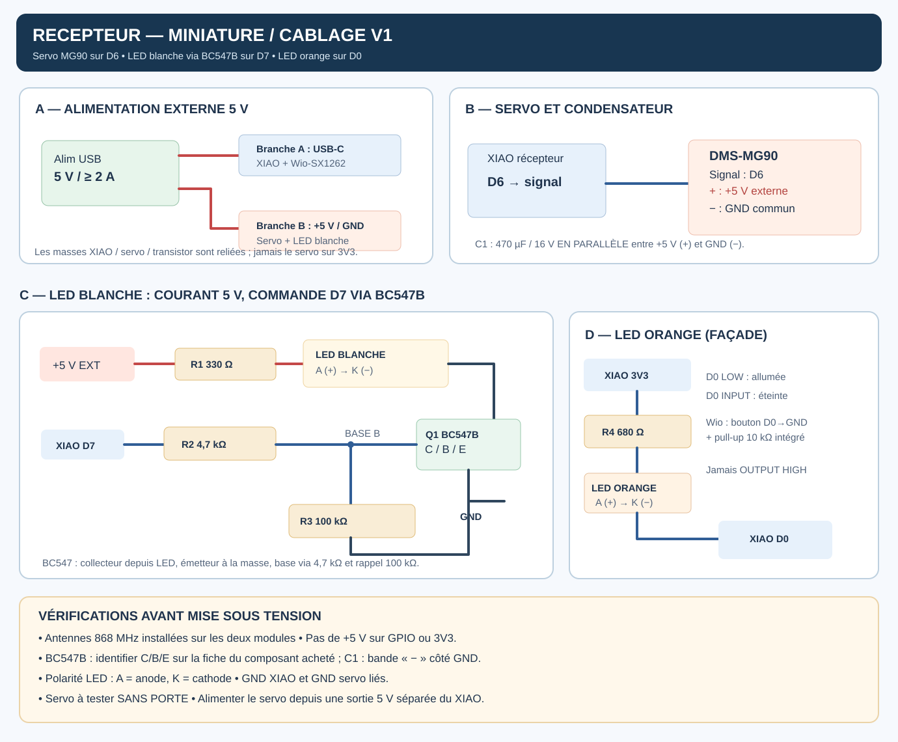
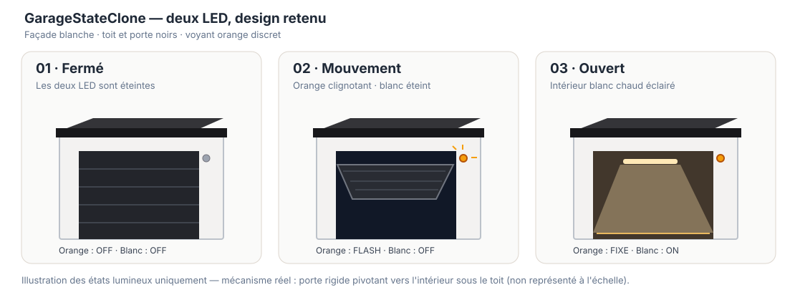

# GarageStateClone — garage miniature LoRa, prototype V1

Reproduire dans une maquette l'état de la vraie porte de garage, sans jamais la commander. Deux kits **Seeed Studio XIAO nRF52840 + Wio-SX1262 à deux barrettes de 7 broches** communiquent directement en LoRa ; ce n'est **pas** la variante Wio B2B pour ESP32-S3.

**État du projet : prototype documentaire et logiciel à valider.** Le dépôt contient un firmware commun à deux rôles, la documentation de câblage, le relevé dimensionnel et un **code source CAO paramétrique**. Les STL/STEP issus du code sont **des prototypes**, non des pièces finalisées et aucune validation physique sur table, mécanique ou radio n'est démontrée. Les références dites « vérifiées » dans les documents correspondent à une revue documentaire, pas à une qualification matérielle. Ce README centralise la V1 retenue ; les documents détaillés restent disponibles en fin de page.

## Sommaire

- [Architecture et sécurité](#architecture-et-sécurité)
- [Matériel et nomenclature complète](#matériel-et-nomenclature-complète)
- [Mécanique retenue](#mécanique-retenue)
- [Câblage et schémas](#câblage-et-schémas)
- [États, angles et LED](#états-angles-et-led)
- [Protocole radio et limites](#protocole-radio-et-limites)
- [Compilation et flash](#compilation-et-flash)
- [Essais et réglages à réaliser](#essais-et-réglages-à-réaliser)
- [Documents, inventaire et sources](#documents-inventaire-et-sources)

## Architecture et sécurité

- **Émetteur, dans le vrai garage** : **un seul SAS308**, détectant uniquement la **fermeture** réelle (aimant face au capteur) ; alimentation USB-C 5 V isolée.
- **Récepteur, dans la maison** : un **DFRobot DMS-MG90** anime uniquement la porte miniature ; une LED blanche chaude éclaire l'intérieur et une LED orange discrète signale les états et anomalies.
- **Liaison directe 868,125 MHz** : sans passerelle, réseau maillé ni Internet. Aucun fil ne relie les deux appareils. Internet n'est nécessaire que pour installer les outils/dépendances au premier build.

**Sécurité impérative :**

- Aucun GPIO ne doit être relié au **230 V**, aux bornes du moteur, à une sortie relais ou à un connecteur de sécurité de la motorisation. Utiliser exclusivement les contacts secs isolés des SAS308 ; conserver toutes les sécurités de la vraie porte.
- Installer capteurs et fils hors des pièces mobiles, ressorts et galets ; éviter tout accrochage et protéger les raccordements de l'humidité.
- GPIO en **3,3 V** : jamais de 5 V sur une entrée/sortie. Le servo est alimenté en **5 V externe**, jamais depuis le 3V3, un GPIO ou les petites pistes du module.
- Répartir la puissance **avant les cartes** et relier les masses du récepteur, du servo et du transistor. Avec deux chargeurs côté miniature, réunir les GND mais **jamais leurs deux +5 V**.
- Brancher les **antennes 868 MHz adaptées avant toute émission**. Couper les alimentations avant de modifier le câblage.
- Usage **indicatif uniquement** : ni dispositif de sécurité, ni preuve de fermeture, ni système d'alarme. Les trames ne sont pas authentifiées et les capteurs ne sont pas supervisés.

## Matériel et nomenclature complète

### Déjà disponible — ne pas racheter

| Quantité | Matériel | À contrôler |
|---:|---|---|
| 2 | Kits XIAO nRF52840 + Wio-SX1262, connecteurs 2 × 7, SKU 102010710 | Antennes 868 MHz et accès aux pastilles D6/D7 du XIAO |
| 1 | Bambu Lab P1S + AMS | Filaments blanc, noir, bleu et rouge disponibles ; privilégier des pièces séparées par couleur |
| 1 | Prise secteur dans le garage réel | Pour un chargeur USB isolé seulement, sans liaison à la motorisation |

### Électronique à monter / achats indicatifs

Achats **100 % Gotronic** (kits déjà possédés exclus). Prix TTC actuels contrôlés sur les fiches directes Gotronic, y compris condensateur et quatre lots de résistances ; relevés navigateur transmis par le chef de projet. Prix et disponibilité restent susceptibles de changer au panier ; aucun délai garanti.

| Quantité montée | Pièce / référence | Prix actuel TTC | Caractéristiques / usage |
|---:|---|---:|---|
| **1** | [SAS308 — Gotronic 26449](https://www.gotronic.fr/art-contact-magnetique-miniature-sas308-12751.htm) | **5,95 €** | 24 × 15 × 6 mm ; écart aimant 15 mm max. ; câble moulé 250 mm ; capteur unique de **fermeture**. Dimensions de l'aimant à mesurer. |
| 1 | [DFRobot DMS-MG90 — Gotronic 36923](https://www.gotronic.fr/art-servomoteur-dms-mg90-32266.htm) | 7,90 € | Positionnel, pignons métal, 4,8–6 V, course annoncée 2 × 90° ; palonnier et visserie inclus |
| 1 | [470 µF / 16 V — Gotronic 04947](https://www.gotronic.fr/art-condensateur-radial-470uf-16v-3386.htm) | 0,20 € | Condensateur polarisé près du servo |
| 1 | [BC547B NPN TO-92 — Gotronic 02173](https://www.gotronic.fr/art-transistor-bc547b-1336.htm) | 0,15 € | Q1, commande de la LED blanche depuis D7 ; identifier C/B/E sur la notice du lot |
| 1 utilisée | [330 Ω — Gotronic 04130](https://www.gotronic.fr/art-5-resistances-1-2w-330-8486-2653.htm) | 0,30 € le lot de 5 | R1, série LED blanche sur +5 V |
| 1 utilisée | [680 Ω — Gotronic 04134](https://www.gotronic.fr/art-5-resistances-1-2w-680-8486-2657.htm) | 0,30 € le lot de 5 | R4, série LED orange sur 3V3 |
| 1 utilisée | [4,7 kΩ — Gotronic 04144](https://www.gotronic.fr/art-5-resistances-1-2w-4-7-k-8486-2667.htm) | 0,30 € le lot de 5 | R2, D7 vers base de Q1 |
| 1 utilisée | [100 kΩ — Gotronic 04160](https://www.gotronic.fr/art-5-resistances-1-2w-100-k-8486-2681.htm) | 0,30 € le lot de 5 | R3, rappel base de Q1 vers GND |
| 1 utilisée | [Whadda WCS101 — Gotronic 03989](https://www.gotronic.fr/art-assortiment-de-130-leds-wcs101-39775.htm) | **9,90 € le lot** | 130 LED **5 mm**, dont **20 blanches chaudes** ; en utiliser une seule, non RGB, sur +5 V via R1 et Q1. Vf, température de couleur et dimensions détaillées à confirmer |
| 1 | [Orange L7113NC 5 mm — Gotronic 03051](https://www.gotronic.fr/art-led-5-mm-l7113nc-2086.htm) | **0,18 €** | Boîtier clair, 15°, 80 mcd à 10 mA annoncés (pas une promesse à notre courant réduit) ; clignotement logiciel |

**Sous-total actuel du panier noyau : 25,48 EUR TTC**, incluant le lot WCS101 entier et les quatre lots de résistances. **Hors port, fournitures et alimentations** : ce n'est pas un total complet ; les achats complémentaires dépendent du stock déjà possédé et du montage retenu. Aucun achat effectué.

### Fournitures nécessaires si absentes

- Au minimum **deux alimentations USB 5 V** : une pour l'émetteur, une **5 V / 2 A minimum** pour la miniature.
- Un **répartiteur de puissance 5 V externe** côté miniature : branche USB-C XIAO et branche 5 V/GND distincte pour servo + LED blanche. Variante : chargeur supplémentaire pour servo + LED blanche, avec GND commun et +5 V séparés.
- **Deux câbles USB-C**, plus le câble/dispositif de distribution d'alimentation du servo.
- Fils souples, fil deux conducteurs pour prolonger les **25 cm moulés du SAS308**, borniers/connecteurs, petite plaque à souder, gaine thermorétractable et isolants.
- Vis pour le SAS308, raccordements protégés, supports imprimés du servo et des LED, adaptateur de palonnier, axe/tourillon et palier gauche, coque et toit démontable.
- Multimètre pour continuité, polarités, résistances, tensions et masses ; outillage de soudure et fixation adapté.

**Références Gotronic et quantités de départ : [tableau des fournitures dans la BOM](docs/BOM_V1_VERIFIEE.md#fournitures-indispensables-si-absentes)** : alimentation HNP18-USBV2 14749 (5 V / 3 A, supérieure au minimum 2 A), câbles USB-A/C, cordon 49101 + bornier PCM10F 48214 pour la puissance servo externe, fil FC50G 08941, perfboard BCS050 12470, gaine FTK01 08918, vis M3 11520 (compatibilité fixation à confirmer). La variante à **trois chargeurs au total** évite un répartiteur non vérifié : deux pour les XIAO, un pour servo/LED ; GND commun côté miniature, **+5 V des deux sources jamais réunis**. Le total complet reste **à chiffrer** selon stock, longueurs, vis et panier final.

## Mécanique retenue

Garage bas et discret : **murs blancs, toit noir mono-pente amovible (+16 mm de pente sur 100 mm de profondeur), porte noire rainurée horizontalement, **sans bandeau bleu** ; retours de mur dans les deux montants de baie. Le visuel de référence est un objet posé sur une étagère ; ce n'est pas un plan coté.

La porte est **monobloc et bascule vers l'intérieur** autour de l'axe horizontal supérieur de la façade. Fermée, elle est verticale ; ouverte, elle se range sous le toit, vers 90° géométriques. L'aspect sectionnel est purement décoratif : **pas de panneaux articulés, rails courbes, ficelle, poulie, crémaillère ni bielle**.

- **DMS-MG90 fixe en haut à droite**, arbre de sortie **coaxial à la charnière supérieure**, entraînement direct par palonnier vissé et adaptateur imprimé.
- **Palier imprimé à gauche**, avec portée/tourillon pour limiter l'effort latéral sur le servo.
- Porte légère et rigide ; une épaisseur de départ d'environ 2 mm reste à ajuster. Prévoir jeux et butées sans jamais maintenir le servo en effort contre une butée.
- Pour une porte de hauteur H, réserver **au moins H + marge vers l'arrière depuis l'axe** ; vérifier toute la trajectoire, épaisseur et accouplement compris. Aucune voiture décorative, LED, électronique ou fil dans le volume balayé.
- **Combles techniques arrière** au-dessus d'un **faux plafond amovible** (XIAO/Wio). LED blanche chaude **5 mm** sous ce faux plafond, tournée vers le plancher ; orange L7113NC **5 mm cachée en retrait**, derrière un **petit point lumineux** en haut à droite de façade : le diamètre entier n'a pas à être visible. Poches et enveloppes CAO **provisoires**, à ajuster après mesure ; câbles le long de la paroi.
- Toit démontable, servo/palonnier démontables, USB-C accessible ; antenne éloignée du métal, du servo et des fils 5 V autant que possible. Tester aussi coque fermée.

**Les cotes de coque sont actuellement des propositions CAO, non validées sur les composants physiques** : **150 × 100 mm**, hauteurs avant/arrière **62/78 mm** et baie **100 × 42 mm**, décentrée de 14 mm vers la gauche. Mesurer en priorité les pattes, l'arbre et le palonnier du servo, l'assemblage XIAO/Wio, l'antenne et les connecteurs avant d'imprimer les fixations définitives. Les angles logiciels 15°/55°/95° ne sont pas des mesures géométriques validées de la porte.

## Câblage et schémas

Les SVG sont des **schémas électriques de principe**, pas des plans PCB ni des vues physiques des broches. Le module Wio relie déjà la radio au XIAO : **aucun SPI supplémentaire à câbler**. D6 et D7 ne sont pas routées sur la carte Wio ; accéder aux **pastilles du XIAO** monté, vérifier à l'ohmmètre, souder et isoler soigneusement.

### Brochage commun et radio

| Signal XIAO | Broche nRF52840 | Usage |
|---|---|---|
| D0 | P0.02 | Récepteur : orange ; partagé avec bouton Wio vers GND et pull-up 10 kΩ vers 3V3 |
| D1 | P0.03 | LoRa DIO1 |
| D2 | P0.28 | LoRa RESET |
| D3 | P0.29 | LoRa BUSY |
| D4 | P0.04 | LoRa NSS |
| D5 | P0.05 | Commutateur RF ; HIGH active la commande par DIO2 |
| D6 | P1.11 | Émetteur : contact fermé ; récepteur : signal servo |
| D7 | P1.12 | Émetteur : **libre en V1 (un seul SAS308 sur D6)** ; récepteur : commande Q1 |
| D8 / D9 / D10 | P1.13 / P1.14 / P1.15 | SPI radio SCK / MISO / MOSI |

### Émetteur — vraie porte

| Départ | Arrivée |
|---|---|
| Chargeur USB isolé 5 V | USB-C du XIAO émetteur |
| D6 | Fil 1 du SAS308 « fermé » |
| D7 | **Non connecté côté émetteur en V1** (ancien second capteur supprimé) |
| GND XIAO | Fil 2 du SAS308 unique |
| Connecteur antenne Wio | Antenne 868 MHz adaptée |

Entrées en `INPUT_PULLUP` : **aimant en face → contact fermé → LOW** ; aimant éloigné → circuit ouvert → HIGH. La désignation commerciale « NF » ne remplace pas un contrôle de continuité de chaque exemplaire. Viser nettement moins que les **15 mm maximum** pour garder une marge contre les vibrations. Aucun bornier intégré aux capteurs ; protéger les prolongations des fils moulés.


### Récepteur — miniature, netlist point à point

| Nœud / composant | Connexions à réaliser |
|---|---|
| D6 | Fil signal du DMS-MG90 uniquement |
| +5 V externe | Alimentation positive servo, borne + de C1, entrée de R1 330 Ω |
| GND commun | GND XIAO, GND alimentation servo, GND servo, borne − de C1, émetteur E de Q1, bas de R3 |
| LED blanche | +5 V externe → R1 330 Ω → anode LED ; cathode LED → collecteur C de Q1 |
| Q1 BC547B | Collecteur C vers LED blanche ; émetteur E vers GND ; base B vers R2 et R3 |
| D7 | D7 → R2 4,7 kΩ → base B de Q1 |
| R3 100 kΩ | Base B de Q1 → GND, maintien éteint au démarrage |
| LED orange | 3V3 XIAO → R4 680 Ω → anode LED ; cathode LED → D0 |
| C1 470 µF / 16 V | En parallèle près du servo : + au +5 V externe, bande − côté GND |
| USB-C XIAO | Branche d'alimentation distincte de la branche de puissance servo |

**LED blanche :** une Vf annoncée à 3,5 V ne permet pas de garantir l'éclairage depuis D7 en 3,3 V. Le montage retenu fournit le courant depuis **+5 V via 330 Ω et BC547B** ; D7 HIGH commande l'allumage, LOW l'extinction. Vérifier C/B/E selon la notice du transistor livré, pas selon la seule forme TO-92. Cette branche vise une LED THT de faible courant, **pas une LED de puissance 1 W/3 W**.

**LED orange :** D0 est partagé avec le bouton Wio. Le firmware l'allume en **sortie LOW**, l'éteint en **INPUT haute impédance**, et **ne doit jamais le piloter en sortie HIGH** avec ce câblage. Un appui sur le bouton peut également allumer la LED ; ce n'est pas une commande de porte.

Le condensateur aide lors des appels de courant du servo mais ne remplace pas une alimentation adaptée. Ne pas faire transiter cette puissance dans le XIAO.



## États, angles et LED

**Capteur unique SAS308 :** l'aimant présent permet de confirmer **FERMÉ**. L'aimant absent ne confirme **pas** l'ouverture. Pour l'objet décoratif, l'émetteur envoie INTERMÉDIAIRE immédiatement, puis **OUVERT estimé** si le capteur reste inactif plus de **40 s**, durée réglable ; une porte réellement arrêtée à mi-course sera alors **faussement affichée ouverte**. Ce n'est ni une alarme ni une mesure de sécurité.

| État affiché | Capteur unique D6 | Cible servo | Blanche | Orange |
|---|---|---|---|---|
| FERMÉ **confirmé** | Aimant présent | 15° | OFF | OFF |
| INTERMÉDIAIRE / non fermé | Aimant absent, délai < 40 s | 55° | OFF | Clignote (et 2 Hz si servo bouge) |
| OUVERT **estimé**, non confirmé | Aimant absent depuis ≥ 40 s | 95° | ON après fin course servo | Fixe |
| Radio périmée (>150 s) | Non renseigné | Dernière consigne | OFF | Double flash |
| Défaut capteurs (code 3) | **Impossible** en mode 1 capteur | Pas de nouvelle cible | OFF | 5 Hz si reçu artificiellement |

**Comportement exact du firmware actuel :**

- Au démarrage, le servo n'est **ni attaché ni commandé avant un premier état exploitable 0, 1 ou 2**. Un premier état défaut 3 ne l'initialise pas. À l'attachement, le code écrit d'abord son angle logiciel initial de 15°, puis rejoint la cible : ne pas supposer une position physique connue au démarrage.
- L'animation avance l'angle logiciel d'un degré par pas, espacés d'au moins 25 ms ; elle ne mesure pas la position réelle du servo. « Arrivé » dans le tableau signifie fin du déplacement **logiciel**, sans retour de position physique.
- Un défaut capteurs **ne fixe pas de nouvelle cible et n'arrête pas l'animation** : un mouvement déjà engagé peut finir vers la cible précédente. Il serait donc inexact de promettre un arrêt immédiat ou un servo toujours immobile sur défaut.
- La perte de liaison **n'arrête pas non plus un mouvement engagé**. La miniature conserve ou termine la dernière consigne, mais sa position **n'est plus fiable comme indication de la vraie porte** ; la LED blanche s'éteint.
- Priorités orange : **liaison périmée/absente → défaut → déplacement servo → intermédiaire → ouvert/fermé**. Double flash : deux impulsions de 150 ms, débutant à 0 et 300 ms de chaque période de 2 s.
- Les **40 s côté émetteur** sont un **délai d'ouverture estimée** après disparition de l'aimant ; les **40 s côté récepteur** commandent séparément le voyant orange en état intermédiaire. Aucun des deux délais ne prouve le mouvement réel. Le heartbeat ne relance pas les minuteries.
- Une erreur fatale d'initialisation radio bloque le programme et écrit une erreur série ; le double flash n'est donc pas une garantie dans ce cas.



Le SVG lumineux illustre les LED et l'esthétique, pas la cinématique ni toutes les pannes : se référer au tableau et au firmware pour les détails.

## Protocole radio et limites

Configuration identique sur les deux cartes : **868,125 MHz, bande passante 125 kHz, SF8, CR 4/5, sync privé 0x12, préambule 8, puissance +10 dBm, TCXO 1,8 V**. La radio utilise son CRC contre les erreurs de transmission, pas une authentification.

Trame compacte de **8 octets**, entiers multioctets little-endian sur nRF52840 :

| Octets | Champ | Valeur |
|---|---|---|
| 0–1 | `network`, uint16 | `NETWORK_ID = 0x6A93` |
| 2 | `version` | 1 |
| 3 | `kind` | État `0x53` ; ACK `0x41` |
| 4–5 | `sequence`, uint16 | Compteur de l'émetteur, repris dans l'ACK |
| 6 | `value` | 0 fermé / 1 ouvert / 2 intermédiaire / 3 défaut |
| 7 | `reserved` | Émis à 0 ; non vérifié à la réception |

- Émetteur : première lecture après stabilisation de démarrage, rapport dès la première boucle ; ensuite nouvel état stabilisé pendant **150 ms**, ou heartbeat **60 s** après le rapport précédent.
- **Trois tentatives maximum par rapport**, même séquence ; attente d'ACK **600 ms** après passage en réception, pause de reprise **250 ms**. Pas de boucle de retransmission infinie si la liaison est absente.
- Récepteur : accepte une trame d'état de longueur 8, lecture radio réussie, réseau/version/type attendus et valeur de 0 à 3 ; met à jour l'état, attend **50 ms**, renvoie l'ACK puis revient en réception. Les retransmissions valides sont également acquittées.
- L'émetteur vérifie réseau/version/type et séquence de l'ACK, mais pas sa valeur ni son champ réservé. Il ne s'agit pas d'une preuve de mouvement ou de position physique.
- Fraîcheur invalidée après **plus de 150 s sans état valide**, défaut capteurs compris dans les états reçus. Une nouvelle trame valide rétablit la fraîcheur.

**Limites connues :** aucun chiffrement, authentification, anti-rejeu ou filtrage des séquences anciennes côté récepteur ; `NETWORK_ID` filtre seulement des trames accidentelles. Aucun journal persistant, aucune protection contre le brouillage volontaire, aucun capteur de déplacement continu ni retour de position de la maquette. Un fil de contact coupé peut apparaître comme « non fermé » ; le capteur unique n'est pas une supervision électrique.

**Radio en France :** vérifier les contraintes applicables de puissance rayonnée, antenne et temps d'occupation à 868 MHz. Les messages courts, le heartbeat et les reprises bornées ne constituent **ni un contrôle automatique du rapport cyclique hors scénario normal, ni une certification de conformité**. Augmenter SF allonge les émissions ; renforcer et valider avant une installation pérenne ou un produit distribué.

## Compilation et flash

Le projet [PlatformIO](platformio.ini) utilise Arduino, la plateforme personnalisée `https://github.com/maxgerhardt/platform-nordicnrf52.git`, la carte `xiaoble_adafruit`, `RadioLib @ ^7.1.2` et `Servo @ ^1.2.2`. Les deux rôles sont dans [src/main.cpp](src/main.cpp), sélectionnés par les environnements `emetteur` et `recepteur`. Sans `-e`, seul l'émetteur est construit par défaut.

Installer VS Code + extension PlatformIO, ou PlatformIO Core, puis ouvrir le dossier contenant `platformio.ini`. Depuis ce dossier :

```sh
# Compiler séparément les deux rôles
pio run -e emetteur
pio run -e recepteur

# Brancher un seul kit à la fois, antenne raccordée
pio run -e emetteur -t upload
# Débrancher l'émetteur et brancher le second kit
pio run -e recepteur -t upload

# Journal série du kit connecté
pio device monitor -b 115200
```

En cas d'échec de détection USB, essayer deux pressions rapides sur RESET pour le bootloader UF2 puis relancer l'upload. Les firmwares Meshtastic d'origine seront remplacés : les sauvegarder au besoin **avant** le flash.

Ces commandes sont la procédure à exécuter, **pas une attestation de compilation, flash ou essai matériel réussi**. Le matériel physique et la radio restent à valider.

## Essais et réglages à réaliser

### Contrôles hors tension et première mise sous tension

1. Installer les deux antennes ; vérifier variante des cartes, accès aux D6/D7, isolation, absence de court-circuit et masses communes.
2. Tester le SAS308 avec et sans aimant au multimètre ; confirmer LOW en fin de course active et prévoir une marge sous les 15 mm maximum.
3. Vérifier C/B/E du BC547B, valeurs des quatre résistances, polarités des LED et du 470 µF. Contrôler la distribution 5 V ; mesurer ensuite 5 V servo et 3,3 V XIAO sans provoquer de court-circuit.
4. Alimenter d'abord le récepteur **servo sans porte** et émetteur éteint : après initialisation radio, attendre le double flash, LED blanche éteinte, servo non commandé.
5. Alimenter l'émetteur **sans aimant** : état 2 (non fermé), servo vers 55° ; après **40 s d'absence continue** (+ anti-rebond), état 1 **estimé**, servo vers 95° et blanc allumé lorsqu'il a fini sa course.
6. Approcher l'aimant du **SAS308 unique D6→GND** : état 0 **FERMÉ confirmé**, servo vers 15° ; les deux LED s'éteignent à la fin.
7. Retirer à nouveau l'aimant et le remettre avant 40 s : ne jamais déclarer la porte ouverte. **Ne pas raccorder de second contact sur D7** pour la V1.
8. Éteindre l'émetteur pendant plus de 150 s : double flash et blanc éteint ; noter que le dernier déplacement peut finir et que la position n'est plus fiable. Réalimenter l'émetteur et contrôler la resynchronisation.
9. Avec câblage D0 vérifié seulement, appuyer brièvement sur le bouton Wio : il peut allumer l'orange indépendamment de la signalisation logicielle.

### Calibration et construction

- Dans `src/main.cpp`, ajuster `ANGLE_CLOSED`, `ANGLE_MIDDLE`, `ANGLE_OPEN` (15°/55°/95° provisoires). Tester sans porte, puis avec un panneau d'essai ; éviter blocage, frottement, surchauffe et effort en butée.
- Mesurer kit, servo, connecteurs et antenne ; modéliser/imprimer d'abord support servo, accouplement, palier gauche et porte d'essai. Vérifier tout le balayage avant la coque finale à toit amovible. **La CAO V2 paramétrique** dans `cad/generate_cad.py` importe les modèles STEP du MG90, XIAO, Wio et BC547B depuis `cad/refs/`. Les 8 STL et l'assemblage STEP ont été générés localement ; **fixation du palonnier et vis encore à valider**.
- Dans `platformio.ini`, la configuration **V1 à un seul capteur** est maintenant **déjà active** : `OPEN_SENSOR_PRESENT=0`, `SINGLE_SENSOR_OPEN_ESTIMATE_MS=40000UL`. Remplacer la durée par le trajet réel mesuré (en gardant une marge). **L'état 1 est alors une estimation, pas une fin de course ouverte mesurée**.
- Garder `NETWORK_ID` et paramètres radio identiques sur les deux appareils. Tester SF8 avant d'augmenter `RADIO_SF` sur les deux cartes ; adapter l'implantation des antennes avant la puissance ou le temps d'émission.

### Essai radio en situation, non effectué ici

Placer les appareils dans le garage réel et la maison, puis tester les quatre états et les pannes, y compris avec la coque fermée. Déclencher au moins **100 changements simulés sur les contacts/GPIO**, pas 100 cycles de la motorisation ; relever ACK manqués et RSSI dans les logs. Éloigner les antennes de la porte métallique et contrôler la portée après réglage. Consigner les résultats réels avant de parler de validation.

## Documents, inventaire et sources

### Documentation et CAO V1

- [Conception mécanique et éclairage V1](docs/CONCEPTION_MECANIQUE_V1.md) : décisions esthétiques, entraînement coaxial, implantation et étapes de modélisation.
- [Câblage V1 et netlist](docs/CABLAGE_V1_VERIFIE.md) : branchements et précautions électriques.
- [BOM V1 et références d'achat](docs/BOM_V1_VERIFIEE.md) : panier noyau Gotronic, prix actuels contrôlés et fournitures hors noyau.
- [Protocole radio](docs/PROTOCOLE.md) : trame et limites du prototype. Les formulations abrégées « ne pas bouger sur défaut » et « reste où elle était » doivent être lues avec la précision ci-dessus : **pas de nouvelle cible, mais fin possible du mouvement engagé**.

### Inventaire des trois SVG intégrés ci-dessus

| Fichier | Dimensions du SVG | Rôle |
|---|---|---|
| [cablage-emetteur-v1.svg](assets/schemas/cablage-emetteur-v1.svg) | 1200 × 740 | SAS308 unique, D6/GND, D7 libre et USB |
| [cablage-recepteur-v1.svg](assets/schemas/cablage-recepteur-v1.svg) | 1380 × 1140 | Alimentation, servo, condensateur, transistor et deux LED |
| [leds-garage-v1.svg](assets/visuels/leds-garage-v1.svg) | 1110 × 412 | Illustration des états lumineux fermé / mouvement / ouvert, non à l'échelle |

### Sources techniques

- [Seeed : kit XIAO nRF52840 + Wio-SX1262](https://wiki.seeedstudio.com/xiao_nrf52840%26_wio_SX1262_kit_for_meshtastic/)
- [Seeed : schéma Wio-SX1262 pour XIAO V1.0, PDF](https://files.seeedstudio.com/products/113010003/Wio-SX1262%20for%20XIAO%20V1.0.pdf)
- [Seeed : brochage XIAO nRF52840](https://wiki.seeedstudio.com/XIAO_BLE/)
- [Meshtastic : discussion du brochage du kit](https://github.com/meshtastic/firmware/discussions/9424)
- [RadioLib](https://github.com/jgromes/RadioLib)
- [TrapLineLoRa : référence PlatformIO pour le même matériel](https://github.com/schustercp/TrapLineLoRa)
- [Exemple de LED blanche annoncée Vf 3,5 V](https://www.gotronic.fr/art-led-3-mm-l3fwc1-35813.htm) : raison de la commande depuis +5 V via transistor, et non directement depuis D7.
## Dernière révision dimensionnelle et CAO

- [**Tableau exhaustif des cotes connues, réserves et dimensions à mesurer**](docs/ENCOMBREMENT_BOM_V1.md).
- [**CAO CadQuery paramétrique — source reproductible**](cad/generate_cad.py), [notice CAO](cad/README.md).
- Dimensions actuelles de la miniature **150 × 100 mm**, hauteurs avant/arrière **62/78 mm**, toit mono-pente **16 mm / 100 mm**, parois **2,4 mm**, jeu **0,30 mm par face** ; **ne pas confondre** ces choix CAO avec les dimensions fabricant.
- Le **corps** du DMS-MG90 fait **22,3 × 11,8 × 26,3 mm**, mais palonnier, pattes et axe restent **à mesurer avant fabrication définitive**. Le XIAO seul fait **21 × 17,8 mm** ; l'enveloppe radio dans la CAO est une **réserve de service**, non sa taille réelle.


## Dernière révision CAO V2 : géométries STEP réelles fournies

- [**CAO V2 : cotes, implantation et limites de montage**](cad/README.md)
- [**Fichiers STEP d'origine identifiés (nom et SHA-256) et guide d'import**](cad/vendor_models/README.md)
- [**Script de génération paramétrique**](cad/generate_cad.py) et [outil d'extraction des 4 archives](cad/import_vendor_archives.py)
- [**Relevé géométrique et contrôles de collision**](cad/qa_report_v2.json)
- [**Tableau des dimensions du BOM, y compris nouveaux STEP**](docs/ENCOMBREMENT_BOM_V1.md)

**Historique — gabarit décoratif V2 : 184 × 100 mm ; hauteurs 62/65 mm ; parois 2,4 mm ; jeu 0,30 mm par face.** Le montant avant droit a été élargi pour contenir les **oreilles et l'arbre du servo complet** (enveloppe STEP 33,40 × 32,50 × 12,22 mm dans le repère local), placé coaxialement à la charnière supérieure. Le Wio est placé **sous** le XIAO sur le plateau arrière, selon les STEP fournis.

**Les quatre géométries sont maintenant versionnées dans ce dépôt** sous forme de fichiers `cad/refs/*.brep.z.b64` (**BREP compressées sans perte**, avec géométries solides et topologie). `cad/generate_cad.py` les charge automatiquement et régénère l'assemblage STEP ; les fichiers STEP d'origine avec leurs noms/metadonnées restent disponibles dans l'archive V2 jointe à la conversation. Il est également possible d'utiliser `python cad/import_vendor_archives.py chemin/vers/les-4-zips` pour travailler directement à partir des STEP. Avant toute redistribution de modèles tiers, vérifier les droits/licences des sources. Le dossier `stl/` de l'archive contient uniquement les pièces imprimables.

## Réparation CAO et exports automatiques

Les quatre géométries sources `cad/refs/*.brep.z.b64` sont conservées sans perte : **ne pas modifier manuellement ces fichiers compressés** et ne pas faire de résolution de conflit ligne à ligne dans leur contenu. Les STEP et STL **ne sont pas versionnés** ; ils sont **générés** par [`cad/generate_cad.py`](cad/generate_cad.py) pour éviter les conflits de fusion de fichiers CAO binaires.

Une [action GitHub de validation CAO](.github/workflows/cad-validation.yml) reconstruit **8 STEP de pièces + 1 STEP d'assemblage, 2 STEP Onshape de secours et 8 STL**, vérifie les empreintes SHA256 des quatre références, **réimporte les STEP**, teste les volumes, le caractère fermé des STL et les collisions avec les LED et le servo. Les exports sont disponibles dans l'artefact **`garage-state-clone-cad-step-stl`** de la page **Actions**.

### Génération locale

```sh
python -m pip install 'cadquery==2.8.0' 'trimesh==4.11.1'
python cad/generate_cad.py
python cad/qa_geometry.py
python cad/verify_gotronic.py
python cad/test_step_exports.py
```

Les sorties `cad/step/`, `cad/stl/` et les rapports runtime sont ignorés par Git. Le prototype reste **non validé physiquement** ; les fixations de palonnier et les vis MG90 sont à finaliser.


## Import Onshape du XIAO nRF52840

Si Onshape affiche **« REF_XIAO_NRF52840_STEP_NE_PAS_IMPRIMER — contains faults (Preview) »**, il s'agit du modèle **tiers très détaillé** (77 solides) et non d'une des neuf pièces imprimables. **Le BREP original reste conservé sans modification**, mais les exports Onshape utilisent désormais une version **à un seul solide**, limitée au gabarit PCB + USB. Ce gabarit respecte les dimensions hors-tout mais **n'est pas un modèle de fabrication des broches ou des trous de fixation**.

- [**Dépannage détaillé et instructions d'import**](docs/ONSHAPE_IMPORT_XIAO.md).
- `REF_XIAO_NRF52840_SIMPLIFIE_POUR_ONSHAPE.step` : pour remplacer seulement le composant fautif.
- `GarageStateClone_V2_assemblage_STEP_references.step` : ensemble régénéré avec XIAO simplifié.
- `GarageStateClone_V2_STRUCTURE_SANS_REFERENCES_ONSHAPE.step` : neuf pièces du garage, **sans géométries tierces**, si Onshape signale d'autres défauts.

Les **11 STEP** et 8 STL sont générés par le workflow [CAD sur GitHub Actions](.github/workflows/cad-validation.yml), pas fusionnés comme fichiers sources. L'ancien modèle déjà importé dans Onshape **ne sera pas remplacé automatiquement**.

## Historique V3 — joues intérieures, aucun bandeau bleu (dimensions remplacées par V4)

Sur la façade, les retours de tableau **gauche et droit** sont désormais intégrés à la coque, **2,4 mm d'épaisseur** et **10 mm de profondeur vers l'intérieur**, pour masquer le vide latéral derrière la porte. Ils restent **en dehors de la largeur mobile de la porte**, avec **0,30 mm de jeu de chaque côté**. Le palier gauche est légèrement décalé et traversé par l'axe avec un trou Ø3,8 mm ; l'axe du servo à droite est décalé de 1,5 mm pour préserver le retour.

Pour éviter l'interférence avec le MG90 réel, la coque passe à **190 × 100 mm** (au lieu de 184 × 100), sans changement de l'ouverture **110 × 42 mm**, du toit mono-pente ni de la hauteur **62/65 mm**. L'écart provisoire entre le bout du panneau et le servo est porté à **3 mm**, nécessitant un accouplement restant à concevoir. **Le liseré bleu a été entièrement supprimé** des exports, des assemblages et de la vue de signalisation : il ne reste que **8 STL imprimables et 11 STEP générés**. [Détails et validations](docs/RETOURS_FACADE_V3.md).

Les STEP importés auparavant dans Onshape ne changent pas automatiquement ; utiliser le nouvel artefact du workflow [CAD](.github/workflows/cad-validation.yml). Montage mécanique non validé physiquement.

## Implantation compacte V4 — référence actuelle

**Le modèle actuel est une coque de 150 × 100 mm (hauteur 62/65 mm)**, soit 40 mm de moins en largeur que la V3. La porte est **décalée de 14 mm vers la gauche** : ouverture **100 × 42 mm**, **montant gauche 11 mm** (palier compact) et **montant droit 39 mm** (servo). Panneau : **99,4 × 41,4 × 2,4 mm**. Les joues intérieures de 10 mm, le toit noir en pente, les parois de 2,4 mm et l'absence de bandeau bleu sont conservés.

Le **palier gauche est réduit à 5 mm de largeur**, avec patte compacte intégrée ; il a été reculé vers l'intérieur pour éviter d'intersecter la façade. Le servo MG90 reste **en haut à droite, coaxial à l'axe de la porte**. L'accouplement palonnier/porte de 3 mm est toujours un espace provisoire, **non une pièce mécaniquement validée**. Voir le [plan coté V4](docs/IMPLANTATION_COMPACTE_V4.md) et le [générateur](cad/generate_cad.py).

**Important pour Onshape :** télécharger les nouveaux STEP depuis GitHub Actions puis **réimporter le modèle**. L'ancien assemblage STEP ne sera pas automatiquement remplacé. Les contrôles CAO ne remplacent pas une impression d'essai ni une mesure des composants réels.

## Version actuelle V5 : modules radio dans les combles

La miniature conserve ses **150 × 100 mm au sol**, mais le toit noir mono-pente passe de **62 mm à l'avant à 78 mm à l'arrière** (rehausse arrière de 13 mm par rapport à V4, pente de 16 mm sur 100 mm). **Pas de changement du servo ni de la baie** (100 × 42 mm, décentrée vers la gauche).

- Un **faux plafond amovible** (144,6 × 40 mm, épaisseur 2,4 mm) est installé **à l'arrière, Y=55–95 mm, Z=46–48,4 mm**, sur deux petits appuis solidaires des murs latéraux.
- Les références STEP **XIAO nRF52840 + Wio-SX1262** sont déplacées **au-dessus**, sous le toit, avec environ **6,2 mm de marge verticale modélisée** sous la pente au début de leur enveloppe ; les câbles USB, l'antenne et leurs rayons de courbure **restent à valider**.
- La **LED blanche** est désormais fixée **sous le faux plafond**, vers Y=61,5 mm, et non collée au toit. Son passage de fils Ø2,4 mm traverse le faux plafond. La LED orange et le servo restent à l'avant.
- Une ouverture arrière basse existante est conservée, et une **nouvelle ouverture haute 16 × 9 mm** est ajoutée pour l'alimentation/connexion de la zone des combles.
- **8 STL et 11 STEP** sont toujours générés par GitHub Actions ; le faux plafond remplace l'ancien plateau arrière. Aucun changement du firmware ni du BOM électronique.

[**Plan et précautions de montage du toit/combles V5**](docs/TOIT_COMBLES_V5.md). Le modèle est encore **un prototype mécanique** ; valider les branchements du XIAO, la fixation du PCB, le palonnier et les passages d'antenne avec le matériel réel avant impression définitive.
