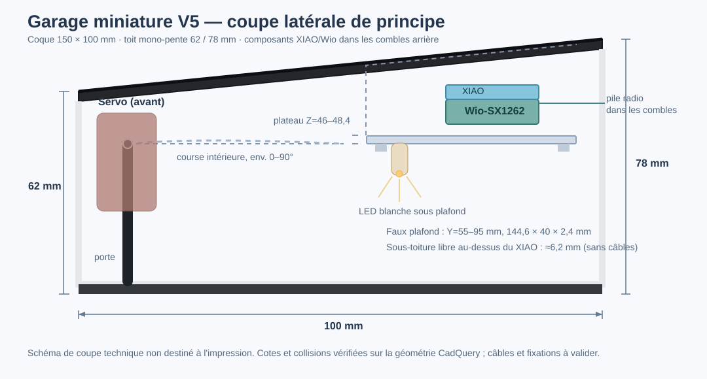

# V5 — toit plus pentu, module XIAO/Wio dans les combles

> **ARCHIVE de conception V5 : ne pas fabriquer depuis ces cotes.** En V6, la LED blanche est à X75/Y65, son support possède deux ergots Ø2, le palier/servo et les cartes ont de nouvelles fixations. Les cotes actuelles sont dans [ASSEMBLAGE_V6.md](ASSEMBLAGE_V6.md) et [README](../README.md).

**Statut : prototype CAO validé numériquement, pas encore imprimé ni assemblé.** Source paramétrique : [`cad/generate_cad.py`](../cad/generate_cad.py). Importation Onshape : STEP générés automatiquement via GitHub Actions. Le firmware et les références BOM électroniques restent inchangés.

## 1. Principe retenu

Conserver le garage compact blanc et noir **150 × 100 mm**, sa **porte décentrée** de 100 × 42 mm et son servo **à l'avant haut droit**. Relever seulement le **bord arrière du toit** pour ménager une petite zone technique fermée visuellement par un **faux plafond amovible** dans les **45 derniers millimètres de profondeur**. La LED blanche ne reste pas collée au toit : elle est installée sous le faux plafond, hors du mouvement de la porte.

| Cote, repère local CAO | V4 | **V5 retenue** |
|---|---:|---:|
| Encombrement au sol | 150 × 100 | **150 × 100 mm** |
| Toit à l'avant | 62 | **62 mm** |
| Toit à l'arrière | 65 | **78 mm** |
| Différence de hauteur sur profondeur 100 | 3 | **16 mm** (angle **≈9,1°**) |
| Toit noir, épaisseur nominale | 3 | **3 mm** |
| Murs blancs, épaisseur | 2,4 | **2,4 mm** |
| Baie (décentrée à gauche) | 100 × 42 | **100 × 42 mm** |
| Faux plafond arrière | absent | **144,6 × 40 × 2,4 mm** |
| Position faux plafond | — | **X=2,7..147,3 ; Y=55..95 ; Z=46..48,4 mm** |
| Appuis latéraux sur murs | absent | **4 mm de largeur × 2,4 mm de hauteur**, fusionnés à la coque |
| Jeu latéral du faux plafond | — | **0,30 mm par face** |
| Ouverture arrière haute, basse tension | absent | **16 × 9 mm**, à valider sur câble USB |
| LED blanche 5 mm (support) | sous toit | **sous le faux plafond**, X=75 / Y=61,5 mm |

La porte rigide noire se relève vers l'intérieur sous l'axe supérieur situé à l'avant. Sa course atteint environ Y≈51 mm ; le faux plafond ne commence qu'à **Y=55 mm**, laissant de l'espace pour le débattement. Le **bandeau bleu reste supprimé**.

## 2. Implantation des éléments

**Au-dessus du faux plafond** :
- Pile **Wio-SX1262 + XIAO nRF52840**, positionnée d'après les vrais STEP fournis, environ **X=63..86 mm**, **Y=70..88 mm**, **Z=51,9..64,0 mm** dans l'assemblage.
- **BC547B** et résistances sur carte d'essai dans une zone arrière, réserve de câblage à confirmer sur la plaque retenue.
- Câble USB-C et antenne 868 MHz dans le volume sous toiture ; entrée basse tension arrière **16 × 9 mm** ; le rayon de courbure et le connecteur SMA/IPEX **ne sont pas inclus dans les STEP**.
- Le XIAO demeure **accessible en retirant le toit noir**, puis en soulevant au besoin le faux plafond. Les fixations définitives du PCB ne sont **pas** conçues.

**Sous le faux plafond** :
- Une seule LED blanche chaude, à **X=75 / Y=61,5 mm** ; support Ø10 mm autour d'une poche provisoire Ø6,6 mm, descente vers **Z=36,2 mm**.
- Passage **Ø2,4 mm** dans le plafond pour ses deux fils ; éviter toute jonction non isolée sous le module LoRa.
- L'éclairage est diffusé dans le garage, **sans gêner l'axe et la porte**.

**Toujours à l'avant** :
- MG90, palier de gauche, LED orange en façade et condensateur 470 µF près du servo.
- Faisceau 3 fils du servo (GND, 5 V régulé, D6) acheminé contre la paroi latérale ; autres signaux D7 et D0 sur leurs circuits respectifs. **Aucun fil ne doit traverser le balayage de la porte**.

## 3. Garde mesurée dans le modèle 3D

Dans l'assemblage CAO V5 :
- **XIAO**, face supérieure de référence : **Z≈64,00 mm**, avec bord avant de l'enveloppe vers **Y≈70,11 mm**.
- **Intrados du toit** à cette abscisse : **Z≈70,22 mm**.
- Écart géométrique entre ces enveloppes : **≈6,22 mm**.

Cette mesure concerne **le solide XIAO simplifié et le toit**. Elle **n'intègre pas** l'antenne, les fils, les boucles de câble, les isolants ni une tolérance d'assemblage. Avant impression définitive, présenter un **gabarit réel** avec la pile Wio/XIAO connectée et vérifier qu'on peut installer le câble USB-C sans forcer sur la prise.

Le Wio, le XIAO et le transistor n'intersectent numériquement **ni le toit, ni le faux plafond, ni les murs**. Le faux plafond ne traverse **ni la porte, ni le servo**, sur les positions testées **de 0 à 90° par pas de 5°**.

## 4. Fabrication et démontage

1. Imprimer la coque blanche avec les **appuis de plafond intégrés** et les retours de tableaux intérieurs ; parois ≥2 mm.
2. Imprimer le faux plafond blanc **séparément**, épaisseur **2,4 mm** et 2 nervures de renfort ; contrôler son jeu **0,30 mm par côté** avant montage des cartes.
3. Monter à blanc le **Wio/XIAO** sur le dessus du plafond en laissant les entretoises/fixations **à concevoir selon le matériel livré**.
4. Positionner la LED blanche et son support sous le plafond, puis faire passer les fils par Ø2,4 mm.
5. Vérifier le passage USB-C par l'ouverture arrière haute, la longueur du faisceau jusqu'au servo, l'antenne LoRa et l'absence de pincement avec le toit.
6. Faire un essai de **porte relevée**, sous tension servo **séparée 5 V**, puis remettre le toit.
7. Vérifier toute la course, l'accès aux connecteurs et la tenue du faux plafond avant usage prolongé.

**Important :** aucune nouvelle pièce électronique n'est nécessaire. Le faux plafond **remplace l'ancien plateau électronique** : la génération conserve **8 STL et 11 STEP** ; l'ancienne référence `07_plateau_electronique_60x31` ne doit plus figurer dans les nouveaux exports.

## 5. Contrôles GitHub

L'action [`cad-validation.yml`](../.github/workflows/cad-validation.yml) régénère les STEP/STL et lance :
- `cad/qa_geometry.py` : validité et volumes des pièces, rapport d'encombrements ;
- `cad/verify_gotronic.py` : cohérence matériel/LED/JSON, collisions de la porte et position de la LED ;
- `cad/test_step_exports.py` : réimportation des **8 STEP de pièces**, fermetures des **8 STL**, empreintes des **4 BREP** et contrôles 3D additionnels **shelf ↔ porte/servo/toit**, **Wio/XIAO/BC547B ↔ toit/plafond**, marge du toit au XIAO **≥5 mm**.

Cela **n'est pas** une validation du montage réel : palonnier servo, fixation des cartes, câbles USB, antenne et comportement radio doivent être testés sur le matériel.

## 6. Fichiers à importer dans Onshape

Après le workflow GitHub Actions, télécharger l'artefact `garage-state-clone-cad-step-stl` puis importer :
- `GarageStateClone_V2_assemblage_STEP_references.step` : **assemblage complet V5**, avec références électroniques simplifiées pour Onshape (nom V2 conservé par compatibilité).
- `GarageStateClone_V2_STRUCTURE_SANS_REFERENCES_ONSHAPE.step` : seulement les **8 pièces imprimables**, si un composant tiers affiche « contains faults ».
- `07_faux_plafond_combles_XIAO.step` : faux plafond seul.

**Un ancien import Onshape n'est pas automatiquement modifié par un push GitHub** : réimporter la nouvelle version.

## Quincaillerie liée aux combles — audit du 22/11/2026

Le **faux plafond est retenu par deux appuis imprimés sur les murs** : **aucune vis M3 ou entretoise de 10 mm n'est nécessaire pour le maintenir** dans le prototype. Pour le Wio/XIAO, privilégier une petite bride **isolante et démontable**, encore à concevoir, plutôt que de percer au hasard les PCB ; le vide sous toit est d'environ **6,2 mm hors câble USB/antenne**. Pour les câbles, prévoir une décharge de traction sur l'ouverture haute arrière 16×9 mm et les fils D6/D7/D0 plaqués sur les parois. **La visserie définitive du servo, son accouplement et les supports du capteur/aimant du vrai garage restent à dimensionner.** Voir le [tableau complet des fixations V5](QUINCAILLERIE_MONTAGE_V5.md).
